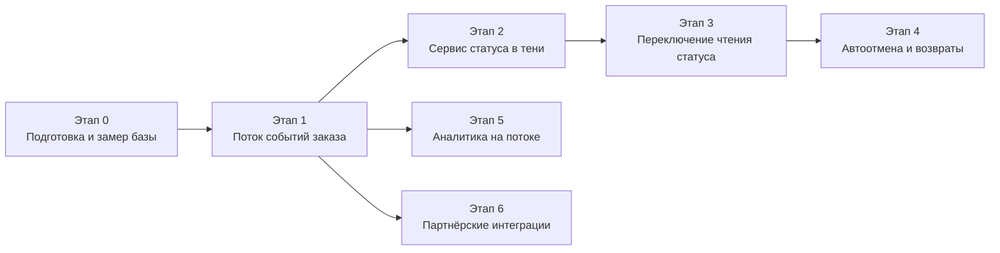

# Roadmap миграции RetailCore

План перехода от текущего состояния к целевому состоянию первого этапа без остановки процессов. Календарных сроков в материалах нет, поэтому этапы заданы условиями входа и критериями завершения. Пороги, доля трафика и длительность параллельной работы остаются открытыми вопросами (раздел 6).

## 1. Принципы миграции

- Результат каждого этапа применим без следующих этапов: если остановиться, система работает, а бизнес сохраняет полученный эффект (допущение A-6, требование спонсора о промежуточной ценности).
- Оформление заказа, платёжная оркестрация и расчёт цены не переносятся. Изменения в монолите и Oracle ограничены перечнем из `transformation.md` (раздел 8): запись событий, обработка отмены по таймауту, возврат при поздней оплате, причина при ручной смене статуса.
- Новые компоненты работают параллельно со старыми: сначала в режиме записи или в тени (пользователи результата не видят), затем на части пользователей, затем на всех.
- У каждого этапа есть откат без потери заказов и без остановки бизнеса.
- Следующий этап начинается только после выполнения критериев завершения предыдущего. Критерии с числовыми порогами определяются после замера базовых значений на этапе 0.
- Изменения в зонах очень высокого риска не проводятся в периоды распродаж и кампаний. Календарь запретов не известен, вопрос адресован спонсору.

## 2. Обзор этапов

Этапы привязаны к горизонтам кейса. Этап 0 вместе с анализом текущего состояния и целевой архитектурой даёт результат «через три месяца»: картину состояния платформы, реестры и базовые значения метрик. Этапы 1–3 должны завершиться до запуска новых сервисов, запланированного «через год», потому что новые сервисы опираются на поток событий и единый статус. Конкретные даты в материалах не заданы.

| Этап | Название | Точка трансформации | Что получает бизнес |
|---|---|---|---|
| 0 | Подготовка и замер базы | Предусловие, не точка | Реестры, базовые значения метрик, ответы на открытые вопросы |
| 1 | Поток событий заказа | Поток событий заказа | Единая история изменений статуса, основа для остальных этапов |
| 2 | Сервис статуса в тени | Сервис статуса заказа и шлюз API | Клиентский и внутренний статус считаются и сверяются со старым, пользователи ничего не замечают |
| 3 | Переключение чтения статуса | Сервис статуса заказа и шлюз API | Клиент и поддержка видят одно и то же, причины отклонений видны оператору |
| 4 | Автоотмена по таймауту и возвраты | Сервис статуса заказа и шлюз API | Неоплаченные заказы сами освобождают товар и слот, поздняя оплата возвращается автоматически |
| 5 | Аналитика на потоке событий | Аналитика на потоке событий | Меньше нагрузки на Oracle, одни определения |
| 6 | Партнёрские интеграции на событиях | Партнёрские интеграции на событиях | Меньше дублей и ручных разборов в логистике |

Статус заказа идёт первым: от него зависят обращения в поддержку, разбор спорных оплат и доверие клиента к статусу и сроку. Аналитика и партнёры получают пользу от того же потока событий, но их проблемы меньше влияют на клиента.

Этапы 5 и 6 зависят только от этапа 1 и могут идти параллельно этапам 2–4 при достаточных ресурсах эксплуатации. Это допущение под вопросом: ресурсы дата-центра близки к пределу (A-4).

## 3. Этапы

### Этап 0. Подготовка и замер базы

| Поле | Содержание |
|---|---|
| Цель | Получить картину, без которой нельзя безопасно менять систему, и зафиксировать базовые значения метрик |
| Работы | Перечень всех мест записи статуса (сервис заказов, платёжный модуль, ночные процедуры, прямой SQL). Реестр интеграций с владельцами и способом обмена. Сквозной номер заказа в монолите и .NET. Замер базовых значений: совпадение статусов у клиента, оператора и логистики; задержка отображения статуса; нагрузка аналитики на Oracle; число обращений по статусу; число дублей заявок. Ответы на открытые вопросы (таблица в разделе 6), в том числе источник события «оплата получена». Закупка и подготовка серверов под брокер и сервис статуса: закупки в собственном дата-центре требуют времени (C-5) |
| Промежуточное состояние | Система работает как раньше. Есть реестры и база метрик |
| Зависимости | Доступ к техническому лидеру, логистике, эксплуатации, поддержке. Журналы административного интерфейса |
| Риски | Перечень мест записи неполный. Данные для замера недоступны. Ответы спонсора откладываются |
| Критерии завершения | Реестр мест записи согласован техническим лидером. Реестр интеграций составлен. Базовые значения записаны с источником. Определены пороги для следующих этапов. Получены ответы спонсора по определению «зарубежных компонентов», таймауту неоплаты и допустимой задержке статуса, либо решено, какие этапы ждут ответа |
| Откат | Не требуется, ничего в системе не меняется |

### Этап 1. Поток событий заказа

| Поле | Содержание |
|---|---|
| Цель | Каждое изменение статуса заказа попадает в единый поток |
| Работы | Развернуть брокер (Kafka) на собственных серверах. Добавить таблицу outbox. Подключить Status Management, платёжный модуль, места прямого SQL и ночные процедуры из реестра так, чтобы событие записывалось в той же транзакции. Публикатор читает outbox и отправляет события в брокер. Режим «только запись»: событий никто не читает. Сверка числа изменений статуса в Oracle и событий в потоке. Если сверка находит изменения без событий и их источник не удаётся найти, этап переходит на захват изменений из журнала Oracle по таблице статусов (условие в `transformation.md`, раздел 8) |
| Промежуточное состояние | Поведение системы для пользователей не меняется. Есть полная история изменений статуса в потоке |
| Зависимости | Этап 0. Брокер на серверах дата-центра. Знание всех мест записи статуса |
| Риски | Пропущено место записи. Нагрузка на Oracle от outbox. Брокер новый для эксплуатации. Публикатор отстаёт |
| Критерии завершения | Все места записи из реестра публикуют события. Число изменений статуса в Oracle и событий в брокере за контрольный период совпадает или расхождения объяснены. Время ответа оформления заказа не ухудшилось относительно базового значения (порог задаётся на этапе 0) |
| Откат | Выключить публикацию (флаг). Таблица outbox остаётся пустой. Монолит работает как раньше |

### Этап 2. Сервис статуса заказа в тени

| Поле | Содержание |
|---|---|
| Цель | Проверить расчёт статуса новым сервисом до того, как его увидят пользователи |
| Работы | Развернуть сервис статуса со своей базой и журналом событий. Загрузить текущие активные заказы (начальный снимок из Oracle). Считать клиентский и внутренний статус из потока. Развернуть шлюз API с маршрутом чтения статуса, закрытым для пользователей. Сверка: для выборки заказов сравнивать новый статус со старым и с фактом у логистики. Согласовать определения статусов и соответствие старых статусов новым |
| Промежуточное состояние | Пользователи по-прежнему видят старый статус. Новый статус считается и сверяется. Расхождения разобраны и классифицированы |
| Зависимости | Этап 1. Определения статусов. Начальная загрузка активных заказов |
| Риски | Часть расхождений остаётся без объяснения. Начальный снимок расходится с данными Oracle. Две модели статусов путают команду |
| Критерии завершения | Доля совпадающих статусов в сверке достигла согласованного порога (порог задаётся на этапе 0). Расхождения сведены к понятным классам с владельцами. Журнал событий хранит историю заказа |
| Откат | Отключить сервис. Пользователи и так не видят его результатов |

### Этап 3. Переключение чтения статуса

| Поле | Содержание |
|---|---|
| Цель | Клиент и поддержка видят статус из нового сервиса |
| Работы | Порядок включения: инструменты поддержки; затем сайт и приложение для части клиентов; затем для всех; последними маркетплейсы, где расхождений больше. Решить, откуда клиент получает письма о статусе, чтобы письмо и кабинет не расходились. Обучить поддержку работе с внутренним статусом и причиной отклонения. Сделать причину обязательной при ручной смене статуса. Через шлюз API идёт только чтение статуса, оформление заказа шлюз не затрагивает. Старый статус остаётся и сверяется. Подробный план: `cutover-plan.md` |
| Промежуточное состояние | Клиент и поддержка видят согласованный статус. Старый статус работает параллельно как резерв |
| Зависимости | Этап 2. Решение по уведомлениям. Обученная поддержка. Наблюдаемость |
| Риски | Потеря прозрачности на переходе. Письма и кабинет расходятся. Клиентский статус «принят, ждём оплату» вместо «подтверждён» вызывает вопросы |
| Критерии завершения | Метрики этапа не хуже базовых значений: совпадение статусов, задержка отображения, число обращений по статусу. Поддержка подтверждает, что причины отклонений видны. Откат не потребовался в течение согласованного периода наблюдения |
| Откат | Флаг возвращает чтение на старый статус для канала или для всех. Данные не откатываются: меняется только источник чтения |

### Этап 4. Автоотмена по таймауту и возвраты

| Поле | Содержание |
|---|---|
| Цель | Неоплаченный заказ освобождает товар и слот доставки, поздняя оплата возвращается автоматически |
| Работы | В режиме наблюдения: сервис статуса отмечает заказы, которые отменил бы по таймауту, но не отменяет. После сверки включить автоотмену: сервис выдаёт команду, монолит снимает резерв товара и слота и записывает статус «отменён» в Oracle. Включить автоматический возврат через платёжный модуль при оплате после отмены и уведомление клиента. Добавить приём команд в Order Processing и платёжный модуль |
| Промежуточное состояние | Правило неоплаты работает. Заказы с неснятым резервом попадают в «требует разбора» |
| Зависимости | Этап 3. Значение таймаута от бизнеса. Изменения Order Processing и платёжного модуля. Платёжный провайдер: поведение возвратов |
| Риски | Неверный таймаут отменяет заказы, которые клиент собирался оплатить. Команда на снятие резерва не доходит или выполняется дважды. Возврат не проходит |
| Критерии завершения | В режиме наблюдения расхождений между «отменил бы» и фактическим состоянием заказов нет. После включения число заказов с занятым слотом без оплаты упало, возвраты проходят автоматически, число заказов в «требует разбора» объяснено |
| Откат | Выключить автоотмену флагом. Сервис возвращается в режим наблюдения |

### Этап 5. Аналитика на потоке событий

| Поле | Содержание |
|---|---|
| Цель | Освободить операционную Oracle от аналитических запросов и привести цифры к общим определениям |
| Работы | Согласовать определения (отмена, возврат, промо) с бизнесом. Развернуть хранилище, наполняемое из потока. Переводить отчёты и задания по одному, каждый сначала сверяя со старым результатом |
| Промежуточное состояние | Часть отчётов читает хранилище, остальные Oracle. Две версии отчёта живут рядом на время сверки |
| Зависимости | Этап 1. Согласованные определения. Владелец определений не назван |
| Риски | Цифры нового хранилища расходятся с эталонными. Две версии отчётов путают пользователей |
| Критерии завершения | Для каждого переведённого отчёта расхождение со старым объяснено. Нагрузка аналитики на Oracle снизилась относительно базового значения |
| Откат | Отчёт возвращается на Oracle |

### Этап 6. Партнёрские интеграции на событиях

| Поле | Содержание |
|---|---|
| Цель | Партнёр получает заказ по событию, а не из таблицы обмена. Дублей и ручных разборов становится меньше |
| Работы | Выбрать первого партнёра с наименьшим риском по реестру интеграций. Выяснить, как .NET-сервис обрабатывает записи таблицы обмена. Сделать адаптер, читающий события. Работать параллельно со старым путём и сверять. Переводить партнёров по одному |
| Промежуточное состояние | Часть партнёров на событиях, остальные на таблицах обмена |
| Зависимости | Этап 1. Реестр интеграций. Сведения о .NET-сервисе. Интерфейсы партнёров не меняются (A-3) |
| Риски | Неизвестная логика .NET-сервиса. Партнёр чувствителен к моменту отправки заявки. Дубли в переходный период |
| Критерии завершения | По переведённому партнёру число дублей и ручных разборов не выросло. Сверка со старым путём без необъяснённых расхождений |
| Откат | Партнёр возвращается на обмен через таблицы |

## 4. Состояния системы по этапам

| После этапа | Что работает | Что остаётся у бизнеса, если остановиться |
|---|---|---|
| 0 | Всё как раньше. Есть реестры и база метрик | Карта рисков и измеренная база |
| 1 | Поток событий пишется, никто не читает | История изменений статуса |
| 2 | Сервис статуса считает статус в тени | Сверка статусов и список расхождений |
| 3 | Клиент и поддержка видят единый статус | Согласованный статус для клиента и поддержки |
| 4 | Автоотмена и возвраты | Резервы освобождаются, поздние оплаты возвращаются |
| 5 | Отчёты на хранилище | Меньше нагрузки на Oracle, общие определения |
| 6 | Партнёры на событиях | Меньше ручных разборов в логистике |

## 5. Зависимости и риски в целом

| Зависимость или риск | Этапы | Мера |
|---|---|---|
| Перечень мест записи статуса неполный | 1, 2, 3 | Этап 0. Сверка числа записей и событий на этапе 1. Не двигаться дальше без совпадения |
| Потеря прозрачности на переходе | 3 | Параллельный период, откат флагом, обучение поддержки, наблюдаемость |
| Письма и кабинет расходятся | 3 | Решение по уведомлениям до этапа 3 |
| Нагрузка на эксплуатацию (брокер, новые сервисы) | 1–6 | Этап 0: оценка ресурсов. Параллельность этапов 5 и 6 только при достаточных ресурсах |
| Скрытая логика в Oracle | 1, 5, 6 | Не переносится. Реестр процедур по мере возможности |
| Ответы спонсора не получены | 2, 4, 5 | Этапы ждут ответа, остальные идут |
| Таймаут неоплаты выбран неверно | 4 | Режим наблюдения перед включением, откат флагом |
| Две версии отчётов и интеграций | 5, 6 | Явные сроки сосуществования, пометки |

## 6. Открытые вопросы, блокирующие этапы

| Вопрос | Адресат | Блокирует |
|---|---|---|
| Что означают «зарубежные компоненты», можно ли открытое ПО | Спонсор | Окончательный выбор брокера и базы статуса, этап 1 |
| Допустимая задержка и расхождение статуса | Спонсор, руководитель поддержки | Критерии этапов 2 и 3 |
| Значение таймаута неоплаты | Спонсор | Этап 4 |
| Срок хранения истории событий | Финансы, бухгалтерия, юристы | Журнал событий на этапе 2 |
| Периоды запретов на изменения (сезоны, распродажи, кампании) | Спонсор | Календарь этапов 1–4 |
| Откуда клиент получает письма о статусе | Руководитель команды заказов, технический лидер | Этап 3 |
| Как .NET-сервис обрабатывает записи таблицы обмена | Внутренняя ИТ-команда | Этап 6 |
| Определения отмены, возврата, промо и их владелец | Спонсор, аналитика, финансы | Этап 5 |
| Права на ручную смену статусов | Руководитель поддержки | Этап 3 |
| Как фиксируется подтверждение оплаты от провайдера (источник события «оплата получена») | Технический лидер, платёжные интеграции | Этапы 2 и 3 |
| Как передавать персональные данные адаптерам доставки | Информационная безопасность | Этап 6 |

## 7. Что вне этого roadmap

Оформление заказа и платёжная оркестрация, расчёт цены (три механизма), перенос логики из Oracle, отказ от Oracle, единая модель заказа по каналам, новые сервисы года. Решение по ним принимается после этапа 3 или 4, когда появятся данные по метрикам и история в потоке событий. Для каждого из этих направлений нужен отдельный roadmap.
